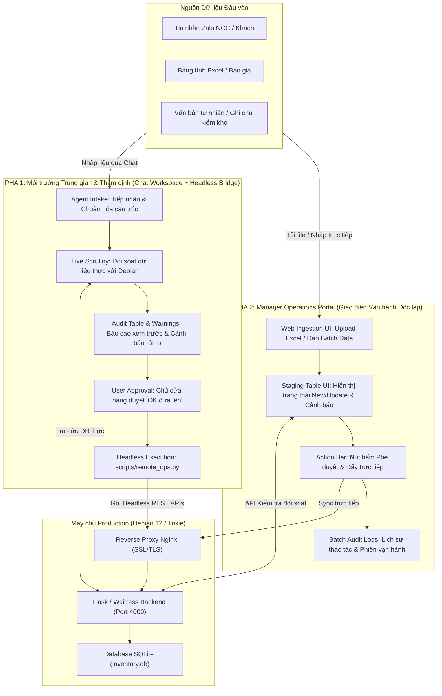
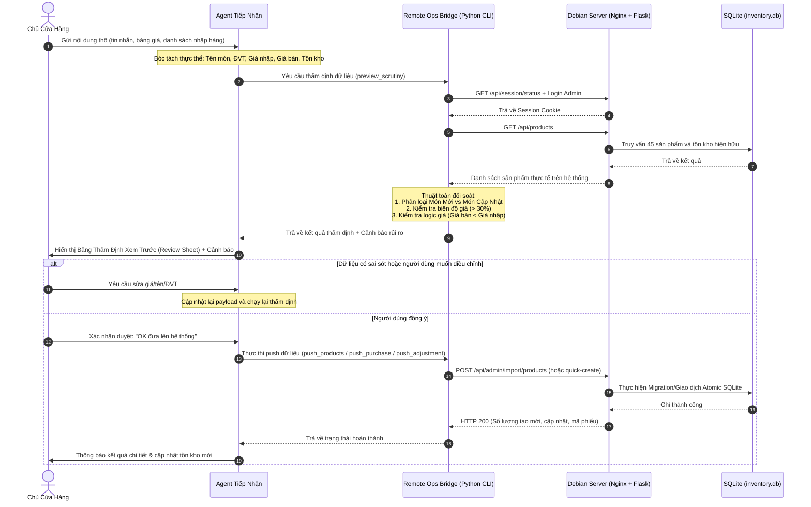
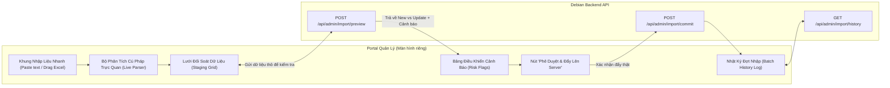

# Sơ đồ Nghiệp vụ & Cơ chế Vận hành: Pha 1 & Pha 2

Tài liệu này mô tả chi tiết kiến trúc, luồng dữ liệu và cơ chế phối hợp đồng bộ giữa **Pha 1 (Môi trường trung gian & Thẩm định qua Agent)** và **Pha 2 (Portal Quản lý Vận hành Chuyên biệt)** nhằm giúp chủ cửa hàng và đội ngũ kỹ thuật triển khai hoàn chỉnh, an toàn, không có độ trễ hay sai sót dữ liệu.

---

## 1. Tổng quan Kiến trúc Hai Pha

---

## 2. Pha 1: Cơ chế Tiếp nhận & Xét kỹ (Intake & Scrutiny Protocol)

Pha 1 là môi trường trung gian hoạt động như **người gác cổng (gatekeeper)** an toàn nhất. Mọi yêu cầu được thẩm định đối chiếu với dữ liệu thực trước khi ghi vào máy chủ Debian.

---

## 3. Pha 2: Portal Quản lý Vận hành (Store Manager Portal)

Khi nhu cầu vận hành thường xuyên hơn và mở rộng cho nhiều người quản lý (Business Manager / Kho trưởng), Pha 2 đóng gói toàn bộ quy trình từ Pha 1 lên một giao diện Web Portal riêng biệt.

---

## 4. Bảng So sánh & Phối hợp Đồng bộ Giữa 2 Pha

| Tiêu chí | Pha 1 (Hiện tại - Agent Bridge) | Pha 2 (Tiến tới - Manager Portal) |
| :--- | :--- | :--- |
| **Giao diện** | Trò chuyện tự nhiên (Chat), dán text tự do | Web Portal chuyên nghiệp, form lưới, upload file kéo thả |
| **Đối tượng dùng** | Chủ shop + Kỹ sư hệ thống (Agent) | Chủ shop, Quản lý kinh doanh (`bizmanager`), Thủ kho |
| **Công cụ lõi** | `scripts/remote_ops.py` (CLI + Python Client) | REST APIs chuyên dụng tích hợp vào Flask app |
| **Ưu điểm** | - Linh hoạt tuyệt đối (hiểu mọi định dạng văn bản thô) - Kiểm tra bằng ngôn ngữ tự nhiên - Không cần sửa frontend UI ngay | - Trực quan, nhiều nhân sự cùng làm việc - Nhanh chóng với số lượng hàng trăm mã - Lưu vết phiên thao tác (Batch sessions) |
| **Tính đồng bộ** | **Dùng chung 1 DB & 1 hệ thống quy tắc** | **Dùng chung 1 DB & 1 hệ thống quy tắc** |

---

## 5. Kế hoạch Triển khai Từng Bước

1. **Bước 1 (Đã hoàn thành - Pha 1 sẵn sàng)**:
   - Cầu nối `scripts/remote_ops.py` đã kết nối an toàn với máy chủ Debian (`https://qts-home.duckdns.org/qltp/`).
   - Đã cấu hình và test thành công các nghiệp vụ: Đăng nhập Master Admin, tra cứu sản phẩm, thẩm định cảnh báo rủi ro giá, đẩy cập nhật lên server.
   - Bạn có thể bắt đầu sử dụng ngay để đưa dữ liệu thực tế lên cửa hàng.

2. **Bước 2 (Vận hành Pha 1 thực tế để chuẩn hóa nghiệp vụ)**:
   - Đưa các danh mục hàng thật, bảng giá và tồn kho thực tế vào chat để chuẩn hóa danh sách sản phẩm.
   - Ghi nhận những tình huống thực tế (các biến thể đơn vị tính, cách đặt tên của các nhà cung cấp khác nhau).

3. **Bước 3 (Thiết kế & Xây dựng Pha 2 - Manager Portal)**:
   - Xây dựng màn hình `/portal` hoặc `/admin/operations` trên frontend.
   - Tận dụng logic đối soát `preview_scrutiny` của Pha 1 chuyển thành endpoint backend `/api/admin/operations/preview`.
   - Bàn giao giao diện cho chủ shop và nhân sự quản trị sử dụng trực tiếp trên trình duyệt hoặc điện thoại.
